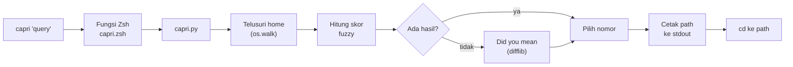

# Capri

**Cari file dan folder dengan fuzzy search, lalu langsung `cd` ke sana.**

Salah ketik sedikit tetap ketemu. Tidak perlu lagi mengetik `cd folder/folder/folder`.


[Fitur](#fitur) &nbsp;|&nbsp; [Demo](#demo) &nbsp;|&nbsp; [Instalasi](#instalasi) &nbsp;|&nbsp; [Cara Pakai](#cara-pakai) &nbsp;|&nbsp; [Cara Kerja](#cara-kerja) &nbsp;|&nbsp; [Konfigurasi](#konfigurasi)

</div>

---

## Tentang

Capri adalah program CLI berbasis Python untuk mencari file dan folder di komputer sendiri. Kamu cukup mengetik sebagian nama (huruf tidak harus menempel, salah ketik sedikit pun tidak masalah), lalu Capri menampilkan hasil terbaik dan memindahkan terminalmu ke folder tujuan.

Capri lahir dari satu masalah pribadi: malas mengetik `cd` berulang kali untuk masuk ke folder yang dalam. Jadi alat ini dibuat untuk dipakai sehari-hari, bukan sekadar latihan.

```console
$ capri sosiologi
```

Satu perintah, dari folder mana pun, dan kamu sudah sampai.

## Fitur

| | Fitur | Keterangan |
|---|---|---|
| `>_` | **Fuzzy matching** | Huruf query tidak harus menempel, asal urutannya sama. `cnfg` menemukan `config`. |
| `#` | **Ranking cerdas** | Bonus untuk huruf berurutan, awal kata, awalan yang sama, dan kecocokan persis. Nama pendek dikalahkan nama panjang hanya kalau memang kurang cocok. |
| `/` | **Cocok lewat path** | Query yang mengandung `/` (misal `nvim/init`) ikut mencocokkan path, bukan cuma nama. |
| `?` | **Did you mean** | Kalau hasil kosong, Capri menyarankan maksimal 3 nama yang paling mirip. |
| `1-9` | **Pilih lewat nomor** | Maksimal 10 hasil teratas, tiap hasil berlabel `DIR` atau `FILE`. Kalau cuma ada satu hasil, langsung dipakai. |
| `cd` | **Pindah folder otomatis** | Memilih folder berarti pindah ke folder itu. Memilih file berarti pindah ke folder induknya. |
| `q` | **Batal dengan tenang** | `q`, `Ctrl+D`, dan `Ctrl+C` membatalkan tanpa error dan tanpa memindahkan folder. |
| `0` | **Tanpa dependensi** | Hanya library standar Python. Tidak ada `pip install`, tidak perlu venv. |

## Demo

Contoh tampilan (isi folder tentu berbeda di komputermu):

```console
$ capri cnfg
1  [DIR ]  ~/.config
2  [DIR ]  ~/.config/nvim/lua/config
3  [FILE]  ~/dotfiles/zsh/config.zsh
Pilih nomor (1-3, q untuk batal): 2
$ pwd
/home/kurta/.config/nvim/lua/config
```

Kalau salah ketik dan tidak ada yang cocok:

```console
$ capri confgi
Did you mean:
1  [DIR ]  ~/.config
Pilih nomor (1-1, q untuk batal): q
$
```

Kalau tidak ada hasil sama sekali:

```console
$ capri zzzzqqq
Tidak ada hasil untuk 'zzzzqqq'
```

## Instalasi

**Kebutuhan:** Python 3.10 atau lebih baru, dan Zsh.

**1. Ambil project ini**

```bash
git clone https://github.com/adikhw/capri ~/projects/capri
```

**2. Tambahkan satu baris ke `~/.zshrc`**

```bash
source ~/projects/capri/capri.zsh
```

Path ke `capri.py` ditentukan otomatis dari lokasi `capri.zsh`, jadi folder project boleh diletakkan di mana saja.

**3. Buka terminal baru**

```bash
exec zsh
```

Selesai. Coba `capri "nama sesuatu"` dari folder mana pun.

> Zsh membedakan huruf besar dan kecil. Nama perintahnya `capri` (huruf kecil). Kalau mau tetap mengetik `Capri`, tambahkan alias terpisah di `.zshrc`: `alias Capri=capri`

## Cara Pakai

```bash
capri "kata kunci"
```

| Perintah | Hasil |
|---|---|
| `capri config` | Cari `config` di seluruh home directory |
| `capri cnfg` | Fuzzy: huruf tidak harus menempel |
| `capri proj main` | Beberapa kata digabung jadi satu query (sama dengan `capri "proj main"`) |
| `capri nvim/init` | Query dengan `/` ikut mencocokkan path |
| `capri CONFIG` | Huruf besar dan kecil tidak dibedakan |

Di daftar hasil, ketik nomor lalu Enter untuk memilih, atau `q` untuk batal.

### Exit code

Exit code adalah bagian dari antarmuka Capri, dan fungsi Zsh memeriksanya sebelum melakukan `cd`.

| Kode | Arti |
|---|---|
| `0` | Ada path hasil untuk dipakai |
| `1` | Tidak ada hasil, atau dibatalkan |
| `2` | Cara pakai salah (query kosong) |

## Cara Kerja

Program Python tidak bisa memindahkan folder dari shell yang memanggilnya, karena `cd` hanya berlaku di proses shell itu sendiri. Karena itu tugasnya dibagi dua: `capri.py` hanya **mencetak path**, dan fungsi Zsh di `capri.zsh` yang **melakukan `cd`**.



### stdout dan stderr dipisah

Fungsi Zsh menangkap `stdout` untuk dipakai `cd`. Karena itu hanya path akhir yang dicetak ke `stdout`. Semua yang lain (daftar hasil, prompt, pesan error) dicetak ke `stderr` sehingga tetap tampil di terminal tanpa mengganggu `cd`.

```console
$ python3 capri.py cnfg 2>/dev/null
/home/kurta/.config
```

### Cara menghitung skor

Fungsi `fuzzy_score` memeriksa apakah semua huruf query muncul di target dengan urutan yang sama, lalu memberi nilai:

- **Poin dasar** untuk setiap huruf yang ketemu
- **Bonus berurutan** kalau huruf menempel dengan huruf query sebelumnya
- **Bonus awal kata** kalau huruf membuka sebuah kata (setelah `/`, `_`, `-`, `.`, atau spasi)
- **Bonus awalan** dan **bonus sama persis** untuk kecocokan yang kuat
- **Penalti panjang** supaya `main.py` mengalahkan `maintenance_notes_2019.txt`

Tiap entry dinilai dua kali: dari **nama**-nya (bobot lebih besar) dan dari **path relatif**-nya (tanpa awalan home directory, supaya kata seperti nama user tidak cocok dengan semua file). Skor tertinggi dipakai. Kalau skor sama, path yang lebih pendek menang, lalu urut abjad.

### Did you mean

Saran hanya dihitung ketika hasil fuzzy kosong, memakai `difflib.get_close_matches` pada nama-nama entry. Satu nama yang dimiliki banyak entry hanya muncul sekali.

## Konfigurasi

Semua angka dan aturan ada sebagai konstanta di bagian atas `capri.py`, jadi gampang disetel sesuai selera.

| Konstanta | Fungsi |
|---|---|
| `START_DIR` | Titik mulai pencarian (default: home directory) |
| `IGNORED_DIRS` | Folder yang tidak ditelusuri, misal `.git`, `node_modules`, `__pycache__`, `.cache`, `.venv`, `venv`, `.npm` |
| `MAX_RESULTS` | Jumlah hasil maksimal yang ditampilkan |
| `MAX_SUGGESTIONS` | Jumlah saran "did you mean" maksimal |
| `CLOSE_CUTOFF` | Ambang kemiripan untuk saran |
| `BONUS_*`, `PENALTI_PANJANG`, `BOBOT_NAMA` | Bobot scoring fuzzy |

## Perilaku dan Batasan

- Folder tersembunyi (misal `.config`) tetap ditelusuri, kecuali yang ada di `IGNORED_DIRS`.
- Symlink tidak diikuti, supaya tidak terjebak loop tanpa henti.
- Folder tanpa izin akses dilewati diam-diam.
- Pencarian membaca ulang isi folder setiap kali dijalankan. Belum ada index.
- Hanya mencari berdasarkan nama dan path, bukan isi file (bukan pengganti `grep`).

## Struktur Project

```
capri/
├── capri.py        # seluruh program: argumen, scan, scoring, tampilan, pilihan
├── capri.zsh       # fungsi Zsh pembungkus (menjalankan capri.py lalu cd)
├── .gitignore
├── README.md
```

## Tentang Project Ini

Capri adalah personal project, dibuat sambil belajar:

- argumen CLI dengan `sys.argv`
- menelusuri folder dengan `os.walk` dan `pathlib`
- menulis algoritma fuzzy scoring sendiri
- mengurutkan dengan `sorted` dan `key`
- perbedaan `stdout`, `stderr`, dan exit code
- `difflib` untuk saran salah ketik
- menyambungkan program Python ke shell lewat fungsi Zsh

Rencana dan tahapan pengerjaannya ada di [CAPRI.md](CAPRI.md).

---

<div align="center">

Dibuat oleh Kurta, karena malas mengetik `cd`.

</div>